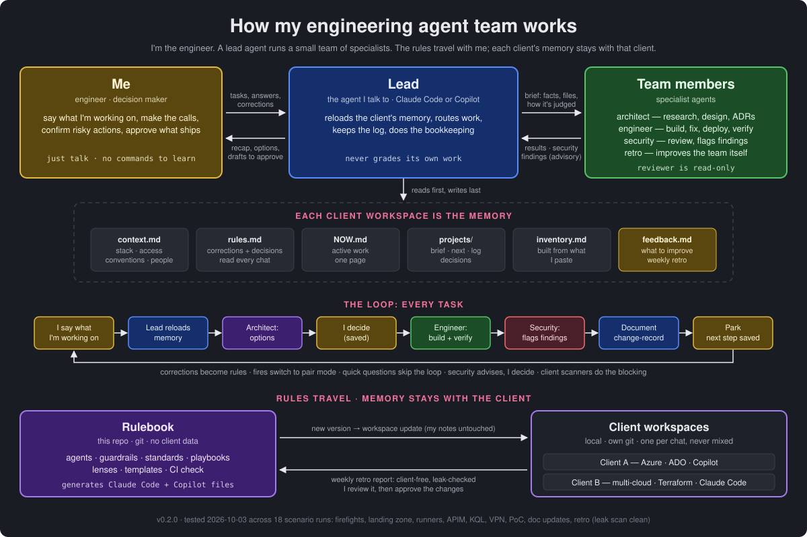

# Engineering Framework

My portable engineering team: a lead agent plus architect, engineer,
security-reviewer and retro specialists, for platform / DevSecOps / network / security
work across Azure, AWS and GCP. Works with Claude Code and GitHub Copilot.

This repo is the team's RULEBOOK. It travels to every engagement and never
holds client data. Each client gets a separate local WORKSPACE that holds that
client's memory: context, standing rules, active work, logs, decisions.



## How it fits together
```
~/engineering-framework/   this repo: agents, rules, playbooks, templates (git)
~/work/client-a/           Client A memory + generated agent files (local git)
~/work/client-b/           Client B memory + generated agent files (local git)
```
A chat opens ONE client workspace plus the rulebook. The other client's folder
is never in the session.

## Quick start
```bash
git clone https://github.com/adesai93/engineering-framework.git ~/engineering-framework
cd ~/engineering-framework
node tools/workspace.mjs new client-a ~/work/client-a --tools copilot
```
Open the workspace (see COMMANDS.md) and say **"onboard me"**. The lead
follows ONBOARDING.md: one batch of questions, then it writes context.md,
NOW.md and rules.md. Two replies; access checks and a team test are optional
later ("verify access", "test the team").
Requires Node 18+ and git.

## Layout
- `agents/` — the team, written once: `team.md` (lead + shared rules),
  `architect.md`, `engineer.md`, `security.md`.
- `base/` — principles (when to ask, STOP zones), standards (secrets,
  security gates, docs), `lenses.md`, playbooks, doc templates.
- `workspace-template/` — what a new client workspace starts as.
- `tools/workspace.mjs` — creates workspaces and generates each tool's agent
  files (Claude Code subagents, Copilot custom agents, instructions).
- `tools/check.mjs` — consistency check; CI runs it on pushes to main and PRs.

## Changing the team
Edit `agents/` or `base/`, run `node tools/check.mjs`, record it in
CHANGELOG.md, then run `node tools/workspace.mjs update <workspace>` for each
workspace. Updates rewrite generated files only, never your notes.

## Client code repos
Clone them into the workspace's `repos/`, or point the workspace at the folder
where they already are: `node tools/workspace.mjs update <workspace> --repos <folder>`.
A chat sees every repo but reads only the one the task needs. Inside a repo,
that repo's own README / CONTRIBUTING / AGENTS.md / CLAUDE.md rules apply too;
the inventory keeps one line per repo as the team learns them.

## Weekly improvement loop
1. At the client: say `retro`. The retro agent writes a client-free report,
   `feedback/<YYYY>-W<ww>.md`, from the week's feedback.md entries,
   corrections and logs, and checks it against that client's names.
2. Read it yourself before it leaves the client, then copy it into this repo's
   `inbox/` (gitignored, never committed).
3. Here, open an agent and say "process the inbox". It follows MAINTAINING.md:
   proposes changes, applies the ones you approve, bumps CHANGELOG.md.
4. Pull the new version at the client and run `workspace.mjs update`.

## Client data
- Workspaces live outside this repo; the setup script refuses to create one
  inside it, and CI fails if client-looking files are committed.
- A workspace has its own local git history and no remote. Push it only where
  the client's contract allows; otherwise back it up encrypted.
- "Local" means the files. Whatever an agent reads is sent to that tool's model
  provider, so use only the AI tools each client has approved for its data.
